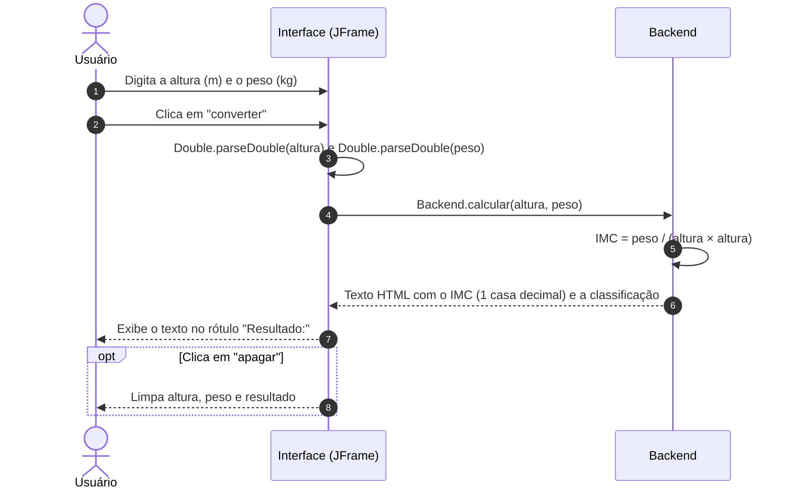

# ❤️ BMI Calculator Desktop — Calculadora de IMC em Java Swing


> Uma janela, dois campos e um botão: informe altura e peso e veja o seu IMC e a faixa de classificação.

O **BMI Calculator Desktop** (na janela, **IMC Calculator**) é um projeto pessoal de estudo: uma calculadora de **Índice de Massa Corporal** feita em **Java** com interface gráfica **Swing**, criada no editor visual do **NetBeans** (projeto Ant, compilado para **Java 8**). A lógica de cálculo fica separada da interface em uma classe própria, aplicando conceitos de **Programação Orientada a Objetos**.



---

## ✨ O Problema

Calcular o IMC à mão é simples, mas exige elevar a altura ao quadrado, dividir e ainda consultar uma tabela para saber em qual faixa o resultado cai.

## 🚀 A Solução

Uma aplicação desktop com uma única janela:

- **Entrada**: campos de altura (em metros) e peso (em quilos).
- **Cálculo**: o IMC é calculado na classe `Backend` e exibido com uma casa decimal.
- **Classificação**: uma mensagem informa a faixa (abaixo do peso, peso ideal, acima do peso ou obesidade graus 1, 2 e 3).
- **Limpeza**: um botão apaga os campos e o resultado.

## 🎯 Diferenciais

- **Visual próprio**: janela sem a borda do sistema (`setUndecorated(true)`), fundo azul-escuro, botões em imagem e controles de fechar/minimizar desenhados como bolinhas no canto da janela.
- **Lógica separada da tela**: `Backend.calcular()` é um método estático que não depende de Swing.
- **Sem dependências**: só a biblioteca padrão do Java (`javax.swing`, `java.awt`).

---

## 🛠️ Stack Tecnológica

| Camada | Tecnologia |
|---|---|
| **Linguagem** | Java (`javac.source`/`javac.target` = 1.8 em `nbproject/project.properties`) |
| **Interface** | Swing (`JFrame` + `GroupLayout`, gerado pelo editor visual do NetBeans a partir de `Interface.form`) |
| **Look and Feel** | Nimbus, quando disponível |
| **Build** | Apache Ant (`build.xml` + `nbproject/build-impl.xml` gerados pelo NetBeans) |
| **IDE** | Apache NetBeans (há também um módulo `IMCCalculator.iml` do IntelliJ IDEA) |

---

## 🏛️ Arquitetura

Duas classes no pacote padrão, sem `package`:

| Classe | Responsabilidade | Métodos |
| :--- | :--- | :--- |
| `Interface` | Janela (`JFrame`), eventos dos botões e ponto de entrada (`main.class=Interface`) | `main()`, `initComponents()`, `btncovertActionPerformed()`, `eraseActionPerformed()`, `fecharMouseClicked()`, `minizarMouseClicked()`, `setIcon()` |
| `Backend` | Cálculo do IMC e montagem da mensagem de resultado | `calcular(Double altura, Double peso)` |

---

## 🧮 Funcionalidades

### Fórmula

$$IMC = \frac{peso}{altura^2}$$

Com altura em metros e peso em quilos. O resultado é formatado com `String.format("%.1f", ...)`, ou seja, uma casa decimal e o separador decimal da localidade do sistema (vírgula em pt-BR).

### Classificação

As faixas são comparadas com o valor **sem arredondamento**, na ordem em que aparecem em `Backend.calcular()`:

| Condição no código | Mensagem exibida |
| :--- | :--- |
| `18.6 <= IMC <= 24.9` | Dentro do peso ideal |
| `IMC < 18.5` | Abaixo do peso ideal |
| `25.0 <= IMC <= 29.9` | Um pouco acima do peso ideal |
| `30.0 <= IMC <= 34.9` | Obesidade grau 1 |
| `35.0 <= IMC <= 39.9` | Obesidade grau 2 (severa) |
| qualquer outro valor (`else`) | Obesidade grau 3 (mórbida) |

Exemplo: altura `1.75` e peso `70` → *"Meus parabéns, seu IMC é de 22,9 Ou seja você esta dentro do peso ideal"*.

### Validação

Não há validação de entrada. Os campos são lidos com `Double.parseDouble`, então a altura precisa usar **ponto** como separador decimal (`1.75`). Veja os efeitos de entradas inválidas em [Limitações conhecidas](#limitações-conhecidas).

---

## 🖥️ Interface (Telas)

A aplicação tem uma única janela, centralizada na tela ao abrir:

| Elemento | Componente | Comportamento |
| :--- | :--- | :--- |
| Cabeçalho | `JLabel` com ícone de coração + texto "IMC Calculator" | Apenas visual (a janela não tem barra de título do sistema) |
| Bolinha vermelha | `JButton` com `Img/Fechar.png` | Fecha a janela (`dispose()`) |
| Bolinha amarela | `JButton` com `Img/MINIZAR.png` | Minimiza a janela (`Frame.ICONIFIED`) |
| Altura (m) | `JTextField` | Texto centralizado |
| Peso (kg) | `JTextField` | Texto centralizado |
| converter | `JButton` com `Img/Converter.png` | Calcula o IMC e mostra o resultado |
| apagar | `JButton` com `Img/Calcular.png` | Limpa altura, peso e resultado |
| Resultado: | `JLabel` com texto HTML | Mostra a mensagem, com quebra de linha automática |

Estados da janela: **vazia** ao abrir, **com resultado** depois de clicar em *converter* e **vazia de novo** depois de *apagar*. O ícone da aplicação na barra de tarefas é o `Icone.png`.

**Resultado para 1,75 m e 70 kg** (`imgGit/iMC.png`):


**Resultado para 1,70 m e 70 kg** (`IMCCalculator/src/Img/Screnshot.png`):


---

## 📁 Estrutura do Projeto

```text
bmi-calculator-desktop/
├── IMCCalculator/                  # Projeto NetBeans (Ant)
│   ├── build.xml                   # Script Ant (importa nbproject/build-impl.xml)
│   ├── manifest.mf
│   ├── IMCCalculator.iml           # Módulo do IntelliJ IDEA
│   ├── nbproject/                  # Configuração do NetBeans (inclui private/)
│   ├── src/
│   │   ├── Interface.java          # Janela Swing e main()
│   │   ├── Interface.form          # Layout do editor visual do NetBeans
│   │   ├── Backend.java            # Cálculo e classificação do IMC
│   │   ├── Icone.png               # Ícone da janela
│   │   └── Img/                    # Imagens dos botões e capturas de tela
│   ├── build/classes/              # Classes compiladas (versionadas)
│   └── out/production/             # Classes compiladas pelo IntelliJ (versionadas)
├── imgGit/
│   └── iMC.png                     # Captura de tela usada no README
├── LICENSE
└── README.md
```

---

## ⚡ Quick Start

### Pré-requisitos
- JDK 8 ou superior.

### 1. Clonar o repositório
```bash
git clone https://github.com/matheusnascimentods/bmi-calculator-desktop.git
cd bmi-calculator-desktop/IMCCalculator
```

### 2. Compilar e executar

```bash
javac --release 8 -d bin src/*.java
java -cp bin:src Interface
```

As imagens da interface são carregadas do classpath (`/Img/...` e `Icone.png`) e ficam em `src/`, por isso `src` entra no `-cp`. No Windows, use `;` no lugar de `:` (`-cp bin;src`). Com JDK 8, troque `--release 8` por `-source 8 -target 8` ou simplesmente omita a opção.

**No NetBeans:** *File → Open Project*, selecione a pasta `IMCCalculator` e clique em *Run Project* (F6).

**Com Ant** (precisa do Apache Ant instalado): `ant jar` gera `dist/IMCCalculator.jar`, que pode ser aberto com `java -jar dist/IMCCalculator.jar`.

---

## 💻 Comandos Úteis

```bash
# Compilar as classes para bin/
javac --release 8 -d bin src/*.java

# Executar com as imagens de src/ no classpath
java -cp bin:src Interface

# Gerar o JAR pelo build do NetBeans (requer Ant)
ant jar

# Conferir a versão do Java
java -version
```

---

## 🎓 Contexto

Projeto pessoal de estudo, feito para praticar Java com interface gráfica Swing e conceitos de **Programação Orientada a Objetos**, separando a lógica de cálculo (`Backend`) da tela (`Interface`). Sinta-se à vontade para explorar, modificar e aprimorar o projeto!

---

## 🔒 Boas Práticas & Limitações

- **Lógica isolada**: o cálculo fica em `Backend`, fora do código gerado pelo editor visual.
- **Sem dependências externas**: compila com qualquer JDK 8+.

### Limitações conhecidas
- **Faixas com lacunas**: valores entre as faixas (por exemplo, IMC de 18,50 a 18,59, ou 24,91 a 24,99) caem no `else` e são classificados como **obesidade grau 3**. Ex.: altura `1` e peso `18.55` mostra "IMC é de 18,6 ... obesidade grau 3 (mórbida)".
- **Sem validação de entrada**: campo vazio, texto ou vírgula decimal (`1,75`) lançam `NumberFormatException`, que só aparece no console; a janela não mostra erro.
- **Altura zero ou valores negativos** são aceitos: altura `0` exibe "IMC é de Infinity ... obesidade grau 3".
- **Janela sem borda**: como é `undecorated` e não há tratamento de arrastar, a janela não pode ser movida com o mouse.
- **Fechar e minimizar** respondem a `mouseClicked`, não à ação do botão; pelo teclado eles não fazem nada.
- **Textos com erros de digitação** nas mensagens (ex.: "esta" sem acento, "seu você esta") e nomes de imagens trocados (`Calcular.png` é o botão *apagar*; `Erase.png` não é usado).
- **Artefatos versionados**: `build/classes/` e `out/production/` (classes compiladas) e `nbproject/private/` (caminhos locais do Windows) estão no repositório; não há `.gitignore`.
- **Sem testes automatizados**.

---

## 🤝 Contribuindo

1. Faça um Fork do projeto
2. Crie uma branch para a sua funcionalidade (`git checkout -b feature/nome-da-feature`)
3. Faça o commit das suas alterações (`git commit -m 'feat: implementa nova funcionalidade'`)
4. Envie para o repositório remoto (`git push origin feature/nome-da-feature`)
5. Abra um **Pull Request** detalhando as alterações

---

## 📄 Licença

Distribuído sob a licença MIT. Veja [`LICENSE`](LICENSE) para mais detalhes.

---
Feito com ❤️ por [@matheusnascimentods](https://github.com/matheusnascimentods)
